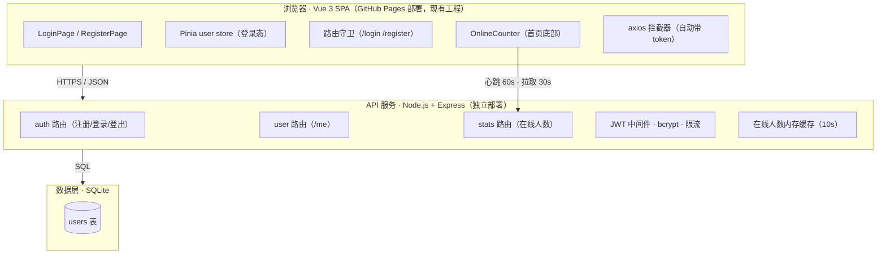
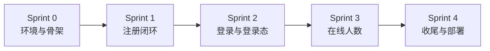

# 初中物理经典实验模拟平台 · 用户系统升级方案

## 文档信息

| 项目 | 内容 |
|---|---|
| 文档版本 | v1.1 |
| 创建日期 | 2026-10-06（v1.1 更新：新增版本管理策略） |
| 状态 | ✅ 方案已确认，v1.0 基线已锁定，待开工 |
| 适用范围 | 用户系统基础版：注册 / 登录 / UID / 资料采集 / 在线人数 |
| 开发模式 | 敏捷迭代（精简 Scrum，单人/小团队，每迭代 1~2 天） |

---

## 0. 版本管理策略（先读）

> 本项目实行严格版本管理：**开工前基线 = v1.0（已锁定）**，开工后进入 **v2.x** 系列；每个迭代完成打 tag，任何时刻可回退到上一个版本。

### 0.1 版本号规则

| 版本 | 含义 | 对应里程碑 |
|---|---|---|
| **v1.0** | 开工前基线（当前代码现状） | git tag `v1.0`（已创建，不可移动） |
| v2.0 | Sprint 0 完成：前后端骨架可运行 | git tag `v2.0` |
| v2.1 | Sprint 1 完成：注册闭环可用 | git tag `v2.1` |
| v2.2 | Sprint 2 完成：登录与登录态 | git tag `v2.2` |
| v2.3 | Sprint 3 完成：首页在线人数 | git tag `v2.3` |
| v2.4 | Sprint 4 完成：上线发布 | git tag `v2.4` |

### 0.2 git 提交约定

- 提交信息遵循 Conventional Commits：`feat:` / `fix:` / `docs:` / `chore:` + 描述
- 每个 Sprint 结束必须打 tag；**tag 一旦创建不移动、不删除**
- 主分支保持"每次提交可运行"，不提交半成品

### 0.3 回退机制

| 场景 | 操作 |
|---|---|
| 当前迭代出问题，回到上一迭代 | `git reset --hard <上一版本tag>`（如 v2.1 → v2.0） |
| 回到开工前基线 | `git checkout v1.0` |
| 只回退单个文件 | `git checkout v1.0 -- <文件路径>` |
| 回退前保护未提交工作 | 先 `git stash`，回退完成后 `git stash pop` |

> ⚠️ 回退前务必确认工作区状态：未提交的在途工作先 stash 或提交，避免丢失。

### 0.4 版本操作记录

| 日期 | 操作 |
|---|---|
| 2026-10-06 | 创建 git tag `v1.0`（指向 main 分支 HEAD `8b76bd3`），锁定开工前基线 |

---

## 1. 背景与目标

当前平台是部署在 GitHub Pages 的纯静态站点（Vue 3 + Vite 8 + vue-router 4），**无账号体系、无后端服务**。本次升级为用户系统基础版，打通「注册 → 登录 → 在线使用」的完整闭环，为后续功能（实验记录、收藏、教师/学生差异化）打地基。

### 1.1 本期升级目标

1. 支持用户注册与登录，登录态可保持（刷新不丢）
2. 注册时自动生成全局唯一 UID
3. 注册采集资料：头像、性别、出生年月日、职业（至少教师/学生两种）
4. 首页底部实时显示当前在线人数（**仅统计已登录用户**）

### 1.2 非目标（本期明确不做）

找回密码、邮箱/手机验证、第三方登录、图形验证码、个人中心页、实名认证、权限分级、访客在线统计。

---

## 2. 关键决策记录（ADR）

| 编号 | 决策点 | 结论 | 状态 |
|---|---|---|---|
| ADR-001 | 后端架构 | 自建 Node.js + Express + SQLite + JWT（方案 C） | ✅ 已确认 |
| ADR-002 | 在线人数口径 | 仅统计最近 3 分钟内有活跃心跳的**已登录用户** | ✅ 已确认 |
| ADR-003 | 防机器人注册 | 本期不做图形验证码，后续迭代评估 | ✅ 已确认 |
| ADR-004 | 个人信息说明 | 注册页添加隐私说明文案（仅用于统计、不公开） | ✅ 已确认 |
| ADR-005 | 前端状态管理 | 引入 Pinia 管理登录态（当前工程无状态库） | ✅ 已确认 |
| ADR-006 | 头像存储 | 预设头像 + 本地上传压缩转 base64 入库（暂不引入对象存储） | ✅ 已确认 |

---

## 3. 范围与优先级（MoSCoW）

### Must（本期必须交付）

- M1 用户注册（用户名/密码/头像/性别/出生年月日/职业）
- M2 自动生成全局唯一 UID
- M3 用户登录 / 登出，JWT 7 天登录态保持
- M4 导航栏登录态展示（「登录/注册」入口 ↔ 头像 + 昵称 + 退出）
- M5 首页底部在线人数实时展示（仅已登录用户）

### Should（本期尽量）

- S1 友好错误提示；登录失败统一文案「用户名或密码错误」（防账号枚举）
- S2 注册/登录接口限流（单 IP 每分钟 10 次）
- S3 注册页隐私说明文案

### Could（条件允许）

- C1 预留 `PUT /api/user/me` 接口（本期不做前端入口）

### Won't（后续 Backlog）

- W1 个人中心页 / 资料修改
- W2 找回密码
- W3 图形验证码
- W4 邮箱/手机绑定、第三方登录
- W5 访客在线统计
- W6 实验数据记录、收藏、排行榜
- W7 教师/学生差异化功能

---

## 4. 技术架构

### 4.1 架构图



### 4.2 技术栈

| 层 | 技术 | 说明 |
|---|---|---|
| 前端（现有） | Vue 3.2 / Vite 8 / vue-router 4 / SCSS | 不做框架迁移 |
| 前端（新增） | pinia / axios | 登录态管理 / HTTP 封装 |
| 后端（新增） | Node.js + Express | 轻量 REST API |
| 数据库（新增） | SQLite | 单文件、零运维；**需持久磁盘** |
| 鉴权（新增） | JWT（HS256，7 天过期） | 无状态会话 |
| 密码（新增） | bcryptjs（cost=10） | 哈希存储，不落明文 |

### 4.3 目录结构规划

```
Physics_class/
├── server/                       # 新增：后端服务
│   ├── app.js                    # Express 入口（中间件、路由挂载）
│   ├── db.js                     # SQLite 初始化 + 建表
│   ├── middleware/
│   │   ├── auth.js               # JWT 鉴权中间件
│   │   └── rateLimit.js          # 简单内存限流
│   ├── routes/
│   │   ├── auth.js               # 注册 / 登录 / 登出
│   │   ├── user.js               # /user/me
│   │   └── stats.js              # /stats/online
│   ├── utils/
│   │   └── uid.js                # UID 生成
│   └── package.json
├── src/                          # 前端（现有工程内新增）
│   ├── api/index.js              # 新增：axios 实例 + 拦截器
│   ├── stores/user.js            # 新增：Pinia store
│   ├── views/
│   │   ├── LoginPage.vue         # 新增：登录页
│   │   └── RegisterPage.vue      # 新增：注册页
│   ├── components/
│   │   └── OnlineCounter.vue     # 新增：首页底部在线人数
│   ├── router/index.js           # 修改：新增路由 + 守卫
│   └── components/NavHeader.vue  # 修改：登录态切换
```

---

## 5. 数据模型与 API

### 5.1 users 表（SQLite DDL）

```sql
CREATE TABLE users (
  id             INTEGER PRIMARY KEY AUTOINCREMENT,
  uid            TEXT NOT NULL UNIQUE,            -- 对外用户ID，如 U7K3Q9X2M
  username       TEXT NOT NULL UNIQUE,            -- 用户名（唯一）
  password_hash  TEXT NOT NULL,                   -- bcrypt 哈希
  avatar         TEXT NOT NULL DEFAULT 'default', -- 预设头像标识 或 base64
  gender         TEXT NOT NULL DEFAULT 'secret',  -- male / female / secret
  birthday       TEXT,                            -- YYYY-MM-DD
  occupation     TEXT NOT NULL DEFAULT 'student', -- teacher / student / other
  created_at     TEXT NOT NULL DEFAULT (datetime('now','localtime')),
  last_active_at TEXT,                            -- 心跳时间，在线统计依据
  UNIQUE (uid)
);
CREATE INDEX idx_users_last_active ON users(last_active_at);
```

### 5.2 API 清单

| 方法 | 路径 | 说明 | 鉴权 |
|---|---|---|---|
| POST | `/api/auth/register` | 注册，返回 uid + token | 否 |
| POST | `/api/auth/login` | 登录，返回用户信息 + token | 否 |
| POST | `/api/auth/logout` | 登出 | 是 |
| GET | `/api/user/me` | 获取当前用户信息 | 是 |
| POST | `/api/heartbeat` | 心跳续活 | 是 |
| GET | `/api/stats/online` | 在线人数（公开） | 否 |

**统一响应格式**：成功 `{ "code": 0, "data": {...} }`；失败 `{ "code": 40001, "message": "用户名已存在" }`（code 规则见附录）。

### 5.3 UID 生成规则

- 格式：`U` + 9 位字符（字符集去除易混淆的 `0/O/1/I`）
- 构成：前 5 位由毫秒时间戳经 base36 派生，后 4 位加密随机
- 示例：`U7K3Q9X2M`——短、可读、不暴露注册顺序
- 唯一性保证：数据库 `UNIQUE` 索引兜底 + 冲突自动重试（最多 3 次）

---

## 6. 功能设计（用户故事）

### US-01 用户注册

> 作为访客，我希望填写用户名/密码/头像/性别/出生年月日/职业完成注册，以便获得平台账号。

**验收标准：**
- [ ] 用户名 2~20 字符（中文/字母/数字/下划线），重复时提示「用户名已被占用」
- [ ] 密码 ≥8 位且必须含字母和数字；确认密码不一致有即时提示
- [ ] 头像：预设 8 个，或本地上传（原图 ≤2MB，压缩后 ≤200KB）
- [ ] 性别 / 出生年月日 / 职业必填；生日范围 1900-01-01 ~ 今天
- [ ] 注册成功即自动登录并跳转首页
- [ ] 注册页含隐私说明：「个人信息仅用于平台统计，不会公开」

### US-02 唯一 UID

> 作为系统，我希望每个用户注册时自动获得唯一 UID，以便标识用户且不暴露注册顺序。

**验收标准：**
- [ ] UID 自动生成、全局唯一（脚本批量注册 100 次无冲突）
- [ ] 格式可读，不含易混淆字符

### US-03 登录与登出

> 作为注册用户，我希望用用户名+密码登录和退出，以便管理我的账号状态。

**验收标准：**
- [ ] 登录成功返回用户信息 + token
- [ ] 账号或密码错误统一提示「用户名或密码错误」
- [ ] 登出后清除 token，导航栏恢复「登录/注册」

### US-04 登录态保持

> 作为已登录用户，我希望刷新页面后仍保持登录，以便持续使用平台。

**验收标准：**
- [ ] token 存 localStorage；应用初始化时恢复并调用 `/user/me` 校验
- [ ] token 过期（401）自动登出回首页，不出现白屏

### US-05 在线人数展示

> 作为访客/用户，我希望首页底部看到当前在线人数，以便感知平台活跃度。

**验收标准：**
- [ ] 已登录用户每 60s 发一次心跳；最近 3 分钟内有活跃心跳者计入在线
- [ ] 首页底部显示「当前 X 人在线使用」，每 30s 自动刷新
- [ ] 多开两个浏览器窗口可见人数变化（同一账号多次登录均计入）
- [ ] 未登录访客不影响该数字

---

## 7. 迭代计划（Sprint）

> 迭代节奏：每迭代 1~2 天，结束必须产出**可运行增量**并通过该迭代 DoD（Definition of Done）。

### Sprint 0 · 环境与骨架

**目标**：前后端工程可运行，数据库就绪。

| 任务 | 说明 |
|---|---|
| 初始化 `server/` | Express 骨架 + SQLite 连接 + users 表建表脚本 |
| 前端引入依赖 | 安装 pinia、axios |
| 环境配置 | `VITE_API_BASE` 环境变量；后端 CORS 白名单 |

**DoD**：`npm run dev`（前端）与 `node server/app.js`（后端）均可启动；`users` 表创建成功。

### Sprint 1 · 注册闭环

**目标**：注册可用，数据真实入库，UID 唯一。

| 任务 | 说明 |
|---|---|
| 注册 API | 校验 → 用户名查重 → 生成 UID → bcrypt 哈希 → 入库 → 签发 JWT |
| 注册页 | 表单 + 前端校验 + 头像选择/上传 + 隐私说明 |
| 自动登录 | 注册成功后跳转首页并写入登录态 |

**DoD**：US-01、US-02 验收标准全过；脚本批量注册 100 次无 UID 冲突。

### Sprint 2 · 登录与登录态

**目标**：登录/登出/刷新保持完整闭环。

| 任务 | 说明 |
|---|---|
| 登录/登出 API | 校验密码、签发/失效 token |
| 登录页 | 表单 + 统一错误提示 |
| Pinia store | 登录态、用户信息、初始化恢复 |
| 路由守卫 + 导航栏 | 登录态切换展示 |
| axios 拦截器 | 自动带 token；401 统一处理 |

**DoD**：US-03、US-04 验收标准全过。

### Sprint 3 · 在线人数

**目标**：首页实时在线人数。

| 任务 | 说明 |
|---|---|
| heartbeat API | 更新 `last_active_at` |
| stats API | 统计 3 分钟窗口内活跃用户数（内存缓存 10s） |
| OnlineCounter 组件 | 首页底部展示 + 30s 轮询 |
| 失败降级 | 请求失败静默隐藏，不阻塞页面 |

**DoD**：US-05 验收标准全过（双窗口实测）。

### Sprint 4 · 收尾与部署

**目标**：上线可用的完整版本。

| 任务 | 说明 |
|---|---|
| 安全复查 | 限流生效、错误文案、HTTPS、无敏感信息泄露 |
| 全量冒烟 | 按 Release DoD 逐条验证并留记录 |
| 部署后端 | 部署到有持久磁盘的服务器，配置环境变量（JWT secret 等） |
| 部署前端 | GitHub Pages 不变，接入线上 API 地址 |
| 文档更新 | 本方案升级至 v1.1，记录实际部署信息 |

**DoD**：Release DoD 全过；线上 URL 可用；冒烟记录留存。

### 迭代依赖关系



---

## 8. 全局验收标准（Release DoD）

- [ ] 新用户可注册，UID 自动生成且唯一
- [ ] 注册采集头像 / 性别 / 出生年月日 / 职业（含教师/学生）
- [ ] 登录后刷新保持登录态，退出后清空
- [ ] 首页底部实时显示在线人数（双窗口可验证）
- [ ] 错误场景提示明确，无白屏无崩溃
- [ ] 受保护接口未登录访问返回 401
- [ ] 部署后全链路可用，冒烟测试记录在案

---

## 9. 风险登记册

| 风险 | 影响 | 应对 |
|---|---|---|
| SQLite 依赖持久磁盘，免费 Serverless 不可用 | 数据丢失/服务不可用 | 部署选择有持久存储的服务器；定期备份 db 文件 |
| 境外/免费托管服务国内访问不稳定 | 体验差 | 后端优先国内节点部署 |
| 头像 base64 入库导致表膨胀 | 性能下降 | 压缩至 ≤200KB；后续迁移对象存储 |
| 生日等个人信息合规 | 法律风险 | 前端隐私说明；最小必要采集；不对外公开 |
| 注册接口被脚本刷 | 垃圾账号 | 限流（本期）；后续图形验证码 |
| 后端服务宕机 | 在线人数不可用 | 前端拉取失败静默降级，不影响其他功能 |

---

## 10. 后续 Product Backlog

| 优先级 | 待办项 | 说明 |
|---|---|---|
| P1 | 个人中心页 / 资料修改 | 前端接入已预留的 `PUT /api/user/me` |
| P1 | 找回密码 | 需先支持邮箱绑定 |
| P2 | 图形验证码 | 防机器人注册 |
| P2 | 实验数据记录 | 用户实验进度 / 结果存档 |
| P3 | 收藏 / 排行榜 | 社区化方向 |
| P3 | 教师/学生差异化 | 教师端布置实验、查看学生完成情况 |
| P3 | 访客在线统计 | 匿名会话机制 |

---

## 11. 附录

### 11.1 敏捷实践约定

- **用户故事**：符合 INVEST 原则（独立、可协商、有价值、可估算、足够小、可测试）
- **验收驱动**：每个故事先列验收标准，实现后逐条勾验，未过不能算完成
- **小步交付**：每个 Sprint 结束都有可运行增量；宁可功能少，必须能跑
- **迭代回顾**：每个 Sprint 结束后记录「做得好 / 待改进」，并更新 Backlog
- **技术债**：遇到「先能用、后优化」的决策，在 Backlog 登记，不悄悄遗留

### 11.2 错误码约定

| code | 含义 |
|---|---|
| 0 | 成功 |
| 40001 | 用户名已存在 |
| 40002 | 用户名或密码错误 |
| 40003 | 参数校验失败 |
| 40100 | 未登录 / token 无效或过期 |
| 42900 | 请求过于频繁（限流） |
| 50000 | 服务器内部错误 |

### 11.3 注册隐私说明文案（拟定）

> 温馨提示：注册信息中的性别、出生年月日仅用于平台统计与功能优化，不会公开展示给其他用户；请放心填写。
